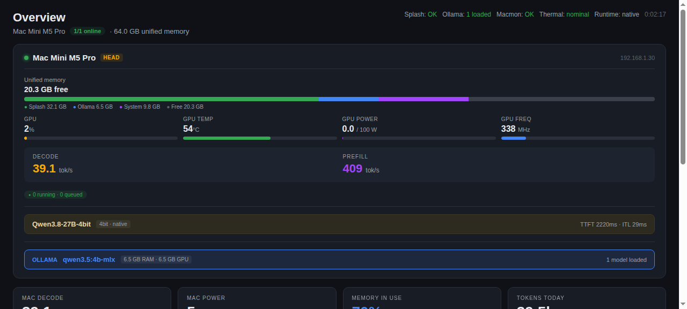

# DashSplash MAC

<p align="center">
  
</p>

Dashboard de monitoreo en tiempo real para **Splash** (motor de inferencia LLM en Apple Silicon) + **macmon** (métricas hardware de GPU/CPU/fan).

> Estilo: réplica de [sparkDash](https://github.com/MiaAI-Lab/sparkDash) adaptado a **un solo equipo** (Mac Mini M5 Pro).

## Qué muestra

| Sección | Fuente | Métricas |
|---|---|---|
| **Header** | Splash + macmon | Estado OK/FAIL, thermal (nominal/fair/serious/critical), runtime, hora |
| **Card nodo** | Splash + macmon + Ollama | Memoria unificada con **desglose por motor** (barra: splash/ollama/system/free + GB de cada uno), GPU util %, temp, power, freq, decode/prefill tok/s, scheduler, modelo splash, modelos ollama, TTFT/ITL |
| **Stats agregados** | Splash + macmon | Decode tok/s (sparkline), power W (sparkline), memoria %, tokens totales |
| **Energy** | macmon | kWh sesión, current W, eficiencia kWh/token, gráfica de barras 24h |
| **Token totals** | Splash | Generated / Cached / Prefill, tabla por modelo |
| **Activity** | Splash + macmon | Log en vivo (decode started/finished, thermal cambios, GPU hot) |
| **Gráficas** | Splash + macmon | GPU temp, power, throughput (líneas 5 min) |

## Arquitectura

```
┌─────────────────────────────────────────────────────────────────┐
│  Mac Mini M5 Pro (192.168.1.x)                                │
│                                                                │
│  ┌──────────────┐         ┌──────────────┐                     │
│  │  Splash      │         │  macmon      │                     │
│  │  :8000       │         │  :9090       │                     │
│  │  /metrics    │         │  /json       │                     │
│  │  (Prometheus)│         │  (JSON)      │                     │
│  └──────┬───────┘         └──────┬───────┘                     │
└─────────┼─────────────────────────┼────────────────────────────┘
          │                         │
          │    HTTP GET (5s poll)  │
          ▼                         ▼
┌─────────────────────────────────────────────────────────────────┐
│  VM Linux (192.168.1.x)                                       │
│                                                                │
│  ┌─────────────────────────────────────────────────────────┐    │
│  │  splash_monitor.py (Flask, :8081)                       │    │
│  │                                                        │    │
│  │  /            → dashboard HTML (template string)        │    │
│  │  /api/splash  → métricas Splash (JSON)                 │    │
│  │  /api/macmon  → métricas macmon (JSON)                 │    │
│  │                                                        │    │
│  │  update_loop() → poll cada 5s, guarda en dict          │    │
│  │  JS fetch     → /api/* cada 5s, dibuja canvas          │    │
│  └─────────────────────────────────────────────────────────┘    │
└─────────────────────────────────────────────────────────────────┘
          │
          │  http://192.168.1.x:8081
          ▼
     Navegador (cualquier equipo en la LAN)
```

### Flujo de datos

1. **Backend** (Python/Flask): `update_loop()` hace `requests.get` a Splash `/metrics` (Prometheus) y macmon `/json` cada 5s, parsea y guarda en dicts en memoria.
2. **Frontend** (JS vanilla): `fetchData()` llama a `/api/splash` y `/api/macmon` cada 5s, acumula en `history[]` (última hora, cap 720 puntos), y redibuja todo el DOM + canvas.
3. Las gráficas usan **canvas 2D** (sin librerías externas): sparklines, barras de energía, líneas de temp/power/throughput.

## Requiere en el Mac

- **Splash** corriendo → expone `:8000/metrics`
- **macmon** corriendo → expone `:9090/json`

```bash
# En el Mac, si no los tienes:
brew install vladkens/macmon/macmon   # macmon
# Splash: instalar según su README
```

## Instalación en la VM

### Requisitos
- Python 3.10+ con `flask` y `requests`
- systemd (Linux)

### 1. Copiar el repo

```bash
git clone <URL> ~/dashsplash
# o: rsync -av dashsplash/ user@192.168.1.x:~/dashsplash/
```

### 2. Instalar dependencias Python

```bash
# Si usas el Python de Hermes:
pip install flask requests
# o crear venv:
python3 -m venv ~/dashsplash/.venv
~/dashsplash/.venv/bin/pip install flask requests
```

### 3. Instalar el servicio systemd

```bash
bash install.sh
```

### 4. Verificar

```bash
systemctl status dashsplash
curl http://localhost:8081/
```

### 5. Abrir en navegador

```
http://192.168.1.x:8081
```

## Configuración

Todo se configura con **variables de entorno** (o un fichero `.env` que el launcher carga). El repo es 100% genérico: no contiene IPs ni URLs personales.

1. **Copia la plantilla** (está gitignored, no se sube):

   ```bash
   cp .env.example .env
   ```

2. **Edita `.env`** con tus valores:

   ```bash
   # .env — tu configuración local (gitignored, nunca se sube a GitHub)
   DASHSPLASH_SPLASH_URL="http://192.168.1.x:8000/metrics"
   DASHSPLASH_MACMON_URL="http://192.168.1.x:9090/json"
   DASHSPLASH_MODEL="Qwen3.8-27B-4bit"
   DASHSPLASH_GPU_TDP="100"          # TDP GPU en vatios
   DASHSPLASH_MEM_GB="54.5"          # memoria unificada en GB
   DASHSPLASH_NODE_NAME="Mac Mini M5 Pro"
   DASHSPLASH_NODE_IP="192.168.1.x"  # solo cosmético (badge)
   DASHSPLASH_PORT="8081"
   ```

3. **Reinicia** el servicio para que cargue los cambios:

   ```bash
   systemctl restart dashsplash
   ```

Sin `.env`, el dashboard arranca con valores por defecto (`127.0.0.1`) — útil para pruebas.

## Archivos

| Archivo | Descripción |
|---|---|
| `splash_monitor.py` | Servidor Flask + HTML/JS del dashboard (~880 líneas) |
| `dashsplash.sh` | Launcher: resuelve el binario Python y arranca el monitor |
| `systemd/dashsplash.service` | Servicio systemd (arranca en boot, `Restart=always`) |
| `install.sh` | Script de instalación (copia servicio, enable, start) |
| `README.md` | Esta documentación |

## Métricas disponibles

### Splash (Prometheus)

| Métrica | Descripción |
|---|---|
| `splash_memory_current_bytes` | RAM unificada en uso (solo lo que splash ve; **no** incluye ollama) |
| `splash_memory_limit_bytes` | Techo de memoria que splash se permite usar (≈ `MEMORY_TOTAL_GB`), **NO** es la RAM total del sistema |
| `splash_memory_headroom_bytes` | Headroom dentro del límite de splash |
| `splash_memory_peak_bytes` | Peak |
| `splash_thermal_state.{nominal,fair,serious,critical}` | Estado térmico |
| `splash_decode_tokens_per_second` | Throughput decode |
| `splash_prefill_tokens_per_second` | Throughput prefill |
| `splash_ttft_p50/p95_milliseconds` | Time to first token |
| `splash_itl_p50/p95_milliseconds` | Inter-token latency |
| `splash_scheduler_decoding` | Jobs decodificando |
| `splash_scheduler_prefilling` | Jobs en prefill |
| `splash_scheduler_queued` | Jobs en cola |
| `splash_kv_pages_allocated/active/cache` | KV cache |
| `splash_kv_allocated_bytes` | KV en bytes |
| `splash_requests_submitted/completed/failed/cancelled_total` | Requests |
| `splash_prefill_input_tokens_total` | Tokens de prefill acumulados |
| `splash_decode_output_tokens_total` | Tokens generados acumulados |
| `splash_drafted_tokens_total` | Tokens de draft (speculative decoding) |
| `splash_accepted_draft_tokens_total` | Draft aceptados |
| `splash_cache_hits/cold_misses/reused_tokens_total` | Cache |

### macmon (JSON)

| Campo | Descripción |
|---|---|
| `temp.gpu_temp_avg` | Temp GPU °C |
| `temp.cpu_temp_avg` | Temp CPU °C |
| `gpu_power` | Power GPU W |
| `cpu_power` | Power CPU W |
| `sys_power` | Power sistema W |
| `gpu_usage` | Utilización GPU (array 0-1) |
| `gpu_freq_mhz` | Frecuencia GPU MHz |
| `cpu_usage_pct` | Utilización CPU % |
| `fans[0].rpm` | RPM ventilador |
| `memory.ram_total` | **RAM total del sistema** (bytes) — la fuente de verdad para la memoria libre |
| `memory.ram_usage` | RAM usada del sistema (bytes) — incluye splash + ollama + OS |
| `memory.swap_total` / `memory.swap_usage` | Swap total/usado (bytes) |

### Ollama (JSON `/api/ps`)

> **Optativo**: si el endpoint no responde, la UI oculta su bloque y no rompe nada.

| Campo | Descripción |
|---|---|
| `models[].name` | Nombre del modelo cargado (p.ej. `qwen3.5:4b-mlx`) |
| `models[].size` | Memoria en uso (bytes) — en Mac unificado es la RAM real del modelo |
| `models[].size_vram` | Misma memoria vista como GPU (pool unificado) — **NO sumar con `size`** (duplica) |
| `models[].expires_at` | Cuándo se descarga de RAM (inactividad) |

**Nota de memoria (Apple Silicon)**: en un Mac con memoria unificada, Ollama reporta el modelo en `size` **y** `size_vram` con el mismo valor (es un solo pool). El dashboard cuenta solo `size` para el segmento Ollama. La barra de memoria total = splash + ollama + system (resto) + free.

## Auto-reinicio y persistencia

El servicio systemd con `Restart=always` + `RestartSec=3` garantiza:
- **Arranque en boot** (`WantedBy=multi-user.target`)
- **Reinicio si el proceso cae** (crash, OOM, etc.)
- **Reinicio si el servidor Flask se queda colgado** (monitorización con watchdog de systemd)

No es necesario el wrapper bash `while true` del `/tmp/run_splash_monitor.sh`.

## Troubleshooting

| Síntoma | Causa | Fix |
|---|---|---|
| 500 Internal Server Error | DASHBOARD es tuple (coma tras `'''`) | Quitar la coma: `'''` no `''',` |
| Gráficas vacías | Canvas `offsetWidth` = 0 al dibujar | Usar `requestAnimationFrame` o `setTimeout(0)` |
| "Splash FAIL" | Splash no responde | Verificar `curl http://192.168.1.x:8000/metrics` |
| "Macmon FAIL" | macmon no responde | Verificar `curl http://192.168.1.x:9090/json` |
| Puerto 8081 ocupado | Proceso zombie | `fuser -k 8081/tcp` |
| Puerto bloqueado en firewall | iptables | `sudo iptables -I INPUT -p tcp --dport 8081 -j ACCEPT` |

## Licencia

MIT
