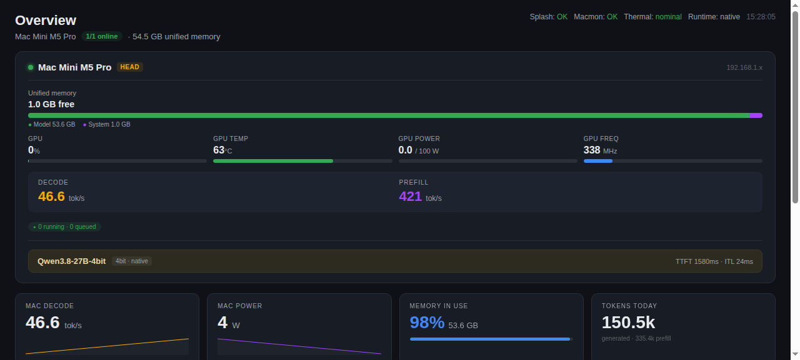

# DashSplash MAC

<p align="center">
  
</p>

<p align="center">
  <strong>Español</strong> · <a href="README.en.md">English</a>
</p>

Dashboard de monitoreo en tiempo real para **Splash** (motor de inferencia LLM en Apple Silicon) + **macmon** (métricas hardware de GPU/CPU/fan) + **Ollama** (modelos cargados, optativo).

> Estilo: réplica de [sparkDash](https://github.com/MiaAI-Lab/sparkDash) adaptado a **un solo equipo** (Mac Mini M5 Pro).
>
> **Ollama es optativo**: si su endpoint no responde, el dashboard lo omite y sigue funcionando con Splash + macmon.

## Qué muestra

| Sección | Fuente | Métricas |
|---|---|---|
| **Header** | Splash + macmon + Ollama | Estado OK/FAIL, `Ollama: N loaded`, thermal (nominal/fair/serious/critical), runtime, hora |
| **Card nodo** | Splash + macmon + Ollama | Memoria unificada con **desglose por motor** (barra: splash/ollama/system/free + GB de cada uno), GPU util %, temp, power, freq, decode/prefill tok/s, scheduler, modelo splash, modelos ollama, TTFT/ITL |
| **Stats agregados** | Splash + macmon | Decode tok/s (sparkline), power W (sparkline), memoria en uso % (RAM real de macmon: splash + ollama + OS), tokens totales |
| **Energy** | macmon | kWh sesión, current W, eficiencia kWh/token, gráfica de barras 24h |
| **Token totals** | Splash | Generated / Cached / Prefill, tabla por modelo |
| **Activity** | Splash + macmon + Ollama | Log en vivo (decode started/finished, thermal, GPU hot, modelos Ollama cargados/descargados) + indicador **Thinking** desde `/api/splash_status`, con interruptor **LIVE / PAUSED** |
| **Cuota OpenCode Go** | API de uso de OpenCode Go | % consumido de las ventanas rolling/semanal/mensual + tiempo hasta el reinicio (throttle 120 s) |
| **Panel admin** | `data/settings.json` | Fondo propio, columnas y orden de tarjetas, tarjetas visibles, rango de energía e intervalo de refresco (el tema claro/oscuro se guarda en `localStorage`) |
| **Minions** | Transcripts de delegación de Hermes | Página aparte `/minions`: un minion por tarjeta con resumen, % de progreso, estado y sparkline (refresco 3 s) |
| **Gráficas** | Splash + macmon | GPU temp, power, throughput (líneas 5 min) |

## Funciones nuevas (sin versión publicada)

Estas cinco funciones ya están en `main`, pero todavía no llevan release etiquetada.

### 1. Panel de cuota OpenCode Go

El bloque *OpenCode Go (delegation quota)*, al pie de la tarjeta de tokens, muestra el consumo de las tres ventanas de cuota de la delegación:

| Ventana | Qué mide |
|---|---|
| `rolling` | Ventana móvil corta |
| `weekly` | Cuota semanal |
| `monthly` | Cuota mensual |

Por cada ventana se muestra el **% consumido** (verde < 70 %, naranja ≥ 70 %, rojo ≥ 90 %) y el tiempo hasta el reinicio (`resets in 3h`, `resets in 5d`, `resetting now`).

- **Endpoint**: `GET /api/opencodego` → `{online, windows: {rolling, weekly, monthly}, fetched_at, reason}`; cada ventana trae `status`, `percent` y `resetsAt`.
- **Throttle de 120 s**: el backend cachea la respuesta 120 segundos, de modo que el bucle de 5 s no martillea la API externa.
- **Sin clave no hay petición**: el panel queda inerte, solo con una línea atenuada (`unavailable · no_api_key`); nunca se pinta un bloque de error.
- Si la API devuelve un HTTP de error o un payload inválido, el bloque muestra `unavailable` con el motivo y el resto del dashboard sigue igual.

Configuración en `.env` (la plantilla ya trae los dos campos):

```bash
DASHSPLASH_OPENCODE_GO_URL="https://opencode.ai/zen/go/v1/usage"
DASHSPLASH_OPENCODE_GO_KEY="your_key_here"   # tu clave real; el repo solo lleva el placeholder
```

> La clave se lee del entorno: `.env` está gitignored y en el repositorio solo aparece `your_key_here`.

### 2. Estado en vivo de las peticiones a Splash

- **Endpoint**: `GET /api/splash_status` — proxy del `/status` de Splash (`DASHSPLASH_STATUS_URL`, por defecto `<splash>/status`): `ready`, `thermal_state`, `reasoning_switch`, contadores del scheduler y lista de `active_requests` (id, phase, tokens de prompt/generados, edad).
- **Indicador "Thinking"** en *Recent activity*: al entrar una petición nueva en el conjunto activo se registra `Thinking on - decode - N tok` (o `... - prefill - N tok ctx`; con varias, `(+N more)`); al vaciarse, `idle`.
- **Edge-triggered**: solo se escribe en el log cuando una petición *entra* o cuando el conjunto se vacía — nunca en cada poll, para no inundar el feed.
- Si `/status` falla se conserva la última instantánea buena: la UI no parpadea a vacío.

### 3. Panel de administración / personalización

Botón de ajustes en la cabecera (junto al del tema). Todo lo que se muestra en la tabla se persiste en el servidor (`data/settings.json`, `GET`/`POST /api/settings`) y se reaplica al recargar. El **tema claro/oscuro** es la excepción: es un ajuste de cliente, vive en `localStorage` y no toca `settings.json`:

| Sección | Opciones |
|---|---|
| **Fondo** | Subir imagen (JPG/PNG/WEBP/GIF/BMP/AVIF, máx. 25 MB) vía `POST /api/bg`, miniatura del fondo actual y botón para quitarlo |
| **Diseño** | Columnas por fila: `Auto`, `1 columna`, `2 columnas`; reordenar tarjetas con ↑/↓; restablecer |
| **Tarjetas** | Mostrar/ocultar cada tarjeta del dashboard |
| **Energía** | Rango por defecto del bloque de energía: `1h`, `24h`, `1 semana`, `1 mes`, `3 meses` |
| **Refresco** | Presets 1 s / 3 s / 5 s / 10 s / 30 s / 1 min, o intervalo personalizado (0,5–600 s) |

Los fondos se guardan en `data/bg/`; `data/` está **gitignored**, así que fotos y ajustes no se suben nunca.

Los tres endpoints que mutan estado (`POST /api/settings`, `POST /api/bg`, `POST /api/energy/clear`) validan las claves contra el esquema existente y, si defines `DASHSPLASH_ADMIN_TOKEN`, exigen la cabecera `X-Admin-Token` (401 si falta o no coincide). Sin la variable, todo sigue abierto como siempre.

### 4. Actividad LIVE / PAUSED

*Recent activity* lleva un interruptor en la cabecera de la tarjeta: `LIVE` mientras el feed se actualiza y `PAUSED` (botón en `OFF`) al pausarlo, lo que oculta la lista y el botón *View all activity*. El estado se guarda en `localStorage` (`dashsplash.activityOn`), se recuerda entre recargas y no afecta al resto del dashboard.

### 5. Panel de minions en vivo

`/minions` es una página propia (estilo dark-neon, con enlace `← DASHBOARD` a la vuelta) que muestra los **subagentes Hermes vivos** en este host, uno por tarjeta:

| Elemento | Qué muestra |
|---|---|
| **Resumen** | La acción actual del minion, en lenguaje llano (del último `tool` del transcript: `terminal(git push)` → «Pushing to git») |
| **Progreso** | Porcentaje 0–100 (≤ 90 mientras trabaja, 100 solo al terminar) y contador de acciones cuando el objetivo enumera pasos reales |
| **Estado** | `WORKING` / `VERIFYING` / `DONE` / `ERROR`, con chip y color por estado |
| **Actividad** | Sparkline de 12 barras (buckets de 10 s, últimos 2 min) + tiempo transcurrido |

- **Endpoint**: `GET /api/minions` → array JSON con `id` (delegación + índice), `goal` (recortado a 120 caracteres), `summary`, `percent`, `status`, `started`, `elapsed`, `last_action`, `steps`, `tools`, `spark` y `steps_total` (solo si el objetivo tiene ≥ 2 pasos).
- **Refresco 3 s** con reconciliación por `id`: las tarjetas se actualizan en sitio (no hay re-render completo), así las animaciones de entrada/salida funcionan.
- **Fuente de datos**: los transcripts en vivo que escribe Hermes en `DASHSPLASH_DELEGATION_LIVE_DIR` (por defecto `~/.hermes/cache/delegation/live`). Un `task-<N>.log` cuenta como vivo si su mtime está dentro de `DASHSPLASH_MINION_LIVE_WINDOW` (120 s por defecto). El parser acepta tanto el formato JSON como el texto append-only (`HH:MM:SS rol | texto`) y cachea por `(mtime, size)`.
- **Seguridad**: todo lo que sale por `/api/minions` pasa por un scrub de credenciales (`oc_sk…`, `sk-…`, `Bearer …`, JWT, `ghp_…`, `AKIA…`, `api_key=…/token=…/password=…` y tokens largos alfanuméricos). La ruta **no** lleva token: por eso el `goal` se sirve recortado en lugar de completo.
- **Token opcional**: si defines `DASHSPLASH_ADMIN_TOKEN`, las rutas que mutan estado exigen `X-Admin-Token` (ver sección 3); `/minions` y `/api/minions` siguen siendo de solo lectura y sin auth (es un panel para la LAN).

## Arquitectura

```
┌───────────────────────────────────────────────────────────────────────────┐
│  Mac Mini M5 Pro (192.168.1.x)                                         │
│                                                                         │
│  ┌──────────────┐    ┌──────────────┐    ┌──────────────┐               │
│  │  Splash      │    │  macmon      │    │  Ollama      │               │
│  │  :8000       │    │  :9090       │    │  :11434      │               │
│  │  /metrics    │    │  /json       │    │  /api/ps     │               │
│  │  (Prometheus)│    │  (JSON)      │    │  (JSON)      │               │
│  └──────┬───────┘    └──────┬───────┘    └──────┬───────┘               │
└─────────┼───────────────────┼───────────────────┼───────────────────────┘
          │                   │                   │
          │      HTTP GET (5s poll, 3 fuentes)   │
          ▼                   ▼                   ▼
┌───────────────────────────────────────────────────────────────────────────┐
│  VM Linux (192.168.1.x)                                                 │
│                                                                         │
│  ┌──────────────────────────────────────────────────────────────┐        │
│  │  splash_monitor.py (Flask, :8081)                           │        │
│  │                                                            │        │
│  │  /            → dashboard HTML (template string)            │        │
│  │  /api/splash  → métricas Splash (JSON)                     │        │
│  │  /api/macmon  → métricas macmon (RAM real, GPU, fans)      │        │
│  │  /api/ollama  → modelos Ollama cargados (JSON)             │        │
│  │                                                            │        │
│  │  update_loop() → poll cada 5s, guarda en dict              │        │
│  │  JS fetch     → /api/* cada 5s, dibuja canvas              │        │
│  └──────────────────────────────────────────────────────────────┘        │
└───────────────────────────────────────────────────────────────────────────┘
          │
          │  http://192.168.1.x:8081
          ▼
     Navegador (cualquier equipo en la LAN)
```

### Flujo de datos

1. **Backend** (Python/Flask): `update_loop()` hace `requests.get` a las **3 fuentes** cada 5s: Splash `/metrics` (Prometheus), macmon `/json` (RAM real del sistema, GPU, fans) y Ollama `/api/ps` (modelos cargados), parsea y guarda en dicts en memoria. Ollama es **optativo**: si su endpoint no responde, la UI lo omite sin romper nada.
2. **Frontend** (JS vanilla): `fetchData()` llama a `/api/splash`, `/api/macmon` y `/api/ollama` cada 5s, acumula en `history[]` (última hora, cap 720 puntos), y redibuja todo el DOM + canvas. La memoria unificada se muestra con **desglose por motor** (splash/ollama/system/free).
3. Las gráficas usan **canvas 2D** (sin librerías externas): sparklines, barras de energía, líneas de temp/power/throughput.

## Requiere en el Mac

- **Splash** corriendo → expone `:8000/metrics`
- **macmon** corriendo → expone `:9090/json`
- **Ollama** corriendo (optativo) → expone `:11434` con `OLLAMA_HOST=0.0.0.0` (para que la VM lo vea por red)

```bash
# En el Mac, si no los tienes:
brew install vladkens/macmon/macmon   # macmon
brew install ollama                   # Ollama (optativo)
brew services start ollama            # o: ollama serve
# Splash: instalar según su README
```

**Ollama por red** (solo si la VM lo consulta): debe escuchar en todas las interfaces.
```bash
OLLAMA_HOST=0.0.0.0 ollama serve     # en vez de 'ollama serve' (que escucha 127.0.0.1)
```

## Instalación en la VM

### Requisitos
- Python 3.10+ con `flask` y `requests`
- systemd (Linux)

### 1. Copiar el repo

```bash
git clone <URL> ~/dashsplash
# o: rsync -av dashsplash/ user@192.168.1.x:~/dashsplash/
```

### 2. Instalar dependencias Python

```bash
# Si usas el Python de Hermes:
pip install flask requests
# o crear venv:
python3 -m venv ~/dashsplash/.venv
~/dashsplash/.venv/bin/pip install flask requests
```

### 3. Instalar el servicio systemd

```bash
bash install.sh
```

### 4. Verificar

```bash
systemctl status dashsplash
curl http://localhost:8081/
```

### 5. Abrir en navegador

```
http://192.168.1.x:8081
```

## Configuración

Todo se configura con **variables de entorno** (o un fichero `.env` que el launcher carga). El repo es 100% genérico: no contiene IPs ni URLs personales.

1. **Copia la plantilla** (está gitignored, no se sube):

   ```bash
   cp .env.example .env
   ```

2. **Edita `.env`** con tus valores:

   ```bash
   # .env — tu configuración local (gitignored, nunca se sube a GitHub)
   DASHSPLASH_SPLASH_URL="http://192.168.1.x:8000/metrics"
   DASHSPLASH_MACMON_URL="http://192.168.1.x:9090/json"
   DASHSPLASH_OLLAMA_URL="http://192.168.1.x:11434/api/ps"   # optativo (modelos cargados)
   DASHSPLASH_MODEL="Qwen3.8-27B-4bit"
   DASHSPLASH_GPU_TDP="100"          # TDP GPU en vatios
   DASHSPLASH_MEM_GB="64"            # memoria unificada total en GB (solo cosmética: el título)
   DASHSPLASH_NODE_NAME="Mac Mini M5 Pro"
   DASHSPLASH_NODE_IP="192.168.1.x"  # solo cosmético (badge)
   DASHSPLASH_PORT="8081"
   DASHSPLASH_KWH_PRICE="0.13"       # €/kWh para el cálculo de coste

   # OpenCode Go — cuota de delegación (optativo)
   DASHSPLASH_OPENCODE_GO_URL="https://opencode.ai/zen/go/v1/usage"
   DASHSPLASH_OPENCODE_GO_KEY="your_key_here"   # sin clave el panel queda inerte

   # Panel /minions — dónde escribe Hermes los transcripts en vivo (optativo)
   DASHSPLASH_DELEGATION_LIVE_DIR="$HOME/.hermes/cache/delegation/live"
   DASHSPLASH_MINION_LIVE_WINDOW="120"          # segundos sin actividad = minion terminado

   # Token compartido opcional para las rutas que mutan estado (vacío = LAN abierta)
   # DASHSPLASH_ADMIN_TOKEN="change_me"
   ```

3. **Reinicia** el servicio para que cargue los cambios:

   ```bash
   systemctl restart dashsplash
   ```

Sin `.env`, el dashboard arranca con valores por defecto (`127.0.0.1`) — útil para pruebas.

## Archivos

| Archivo | Descripción |
|---|---|
| `splash_monitor.py` | Servidor Flask + HTML/JS del dashboard y del panel `/minions` (~4200 líneas) |
| `dashsplash.sh` | Launcher: resuelve el binario Python y arranca el monitor |
| `systemd/dashsplash.service` | Servicio systemd (arranca en boot, `Restart=always`) |
| `install.sh` | Script de instalación (copia servicio, enable, start) |
| `README.md` | Esta documentación (español) |
| `README.en.md` | English documentation |
| `preview.jpg` | Dashboard screenshot |

## Métricas disponibles

### Splash (Prometheus)

| Métrica | Descripción |
|---|---|
| `splash_memory_current_bytes` | RAM unificada en uso (solo lo que splash ve; **no** incluye ollama) |
| `splash_memory_limit_bytes` | Techo de memoria que splash se permite usar (≈ `MEMORY_TOTAL_GB`), **NO** es la RAM total del sistema |
| `splash_memory_headroom_bytes` | Headroom dentro del límite de splash |
| `splash_memory_peak_bytes` | Peak |
| `splash_thermal_state.{nominal,fair,serious,critical}` | Estado térmico |
| `splash_decode_tokens_per_second` | Throughput decode |
| `splash_prefill_tokens_per_second` | Throughput prefill |
| `splash_ttft_p50/p95_milliseconds` | Time to first token |
| `splash_itl_p50/p95_milliseconds` | Inter-token latency |
| `splash_scheduler_decoding` | Jobs decodificando |
| `splash_scheduler_prefilling` | Jobs en prefill |
| `splash_scheduler_queued` | Jobs en cola |
| `splash_kv_pages_allocated/active/cache` | KV cache |
| `splash_kv_allocated_bytes` | KV en bytes |
| `splash_requests_submitted/completed/failed/cancelled_total` | Requests |
| `splash_prefill_input_tokens_total` | Tokens de prefill acumulados |
| `splash_decode_output_tokens_total` | Tokens generados acumulados |
| `splash_drafted_tokens_total` | Tokens de draft (speculative decoding) |
| `splash_accepted_draft_tokens_total` | Draft aceptados |
| `splash_cache_hits/cold_misses/reused_tokens_total` | Cache |

### macmon (JSON)

| Campo | Descripción |
|---|---|
| `temp.gpu_temp_avg` | Temp GPU °C |
| `temp.cpu_temp_avg` | Temp CPU °C |
| `gpu_power` | Power GPU W |
| `cpu_power` | Power CPU W |
| `sys_power` | Power sistema W |
| `gpu_usage` | Utilización GPU (array 0-1) |
| `gpu_freq_mhz` | Frecuencia GPU MHz |
| `cpu_usage_pct` | Utilización CPU % |
| `fans[0].rpm` | RPM ventilador |
| `memory.ram_total` | **RAM total del sistema** (bytes) — la fuente de verdad para la memoria libre |
| `memory.ram_usage` | RAM usada del sistema (bytes) — incluye splash + ollama + OS |
| `memory.swap_total` / `memory.swap_usage` | Swap total/usado (bytes) |

### Ollama (JSON `/api/ps`)

> **Optativo**: si el endpoint no responde, la UI oculta su bloque y no rompe nada.

| Campo | Descripción |
|---|---|
| `models[].name` | Nombre del modelo cargado (p.ej. `qwen3.5:4b-mlx`) |
| `models[].size` | Memoria en uso (bytes) — en Mac unificado es la RAM real del modelo |
| `models[].size_vram` | Misma memoria vista como GPU (pool unificado) — **NO sumar con `size`** (duplica) |
| `models[].expires_at` | Cuándo se descarga de RAM (inactividad) |

**Nota de memoria (Apple Silicon)**: en un Mac con memoria unificada, Ollama reporta el modelo en `size` **y** `size_vram` con el mismo valor (es un solo pool). El dashboard cuenta solo `size` para el segmento Ollama. La barra de memoria total = splash + ollama + system (resto) + free.

## Auto-reinicio y persistencia

El servicio systemd con `Restart=always` + `RestartSec=3` garantiza:
- **Arranque en boot** (`WantedBy=multi-user.target`)
- **Reinicio si el proceso cae** (crash, OOM, etc.)
- **Reinicio si el servidor Flask se queda colgado** (monitorización con watchdog de systemd)

No es necesario el wrapper bash `while true` del `/tmp/run_splash_monitor.sh`.

## Troubleshooting

| Síntoma | Causa | Fix |
|---|---|---|
| 500 Internal Server Error | DASHBOARD es tuple (coma tras `'''`) | Quitar la coma: `'''` no `''',` |
| Gráficas vacías | Canvas `offsetWidth` = 0 al dibujar | Usar `requestAnimationFrame` o `setTimeout(0)` |
| "Splash FAIL" | Splash no responde | Verificar `curl http://192.168.1.x:8000/metrics` |
| "Macmon FAIL" | macmon no responde | Verificar `curl http://192.168.1.x:9090/json` |
| Ollama no aparece en el dashboard | Endpoint no responde / escucha en 127.0.0.1 | Arrancar Ollama con `OLLAMA_HOST=0.0.0.0` y revisar `DASHSPLASH_OLLAMA_URL` |
| Memoria doble en Ollama | Sumar `size` + `size_vram` (pool unificado) | Contar solo `size` (ver sección Ollama) |
| Puerto 8081 ocupado | Proceso zombie | `fuser -k 8081/tcp` |
| Puerto bloqueado en firewall | iptables | `sudo iptables -I INPUT -p tcp --dport 8081 -j ACCEPT` |

## Licencia

MIT
